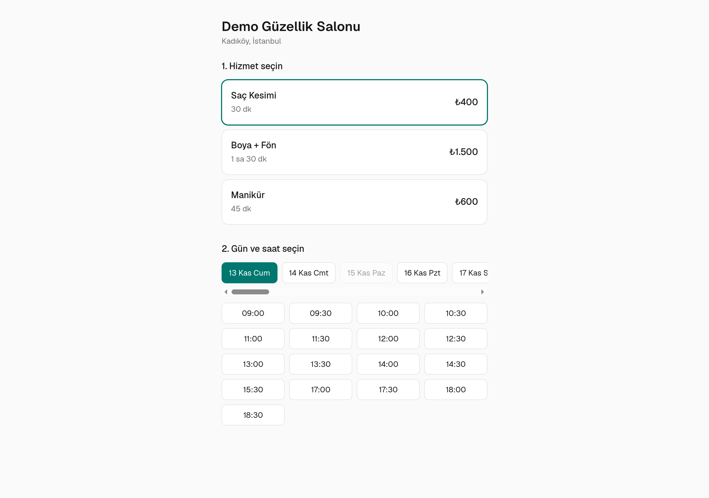
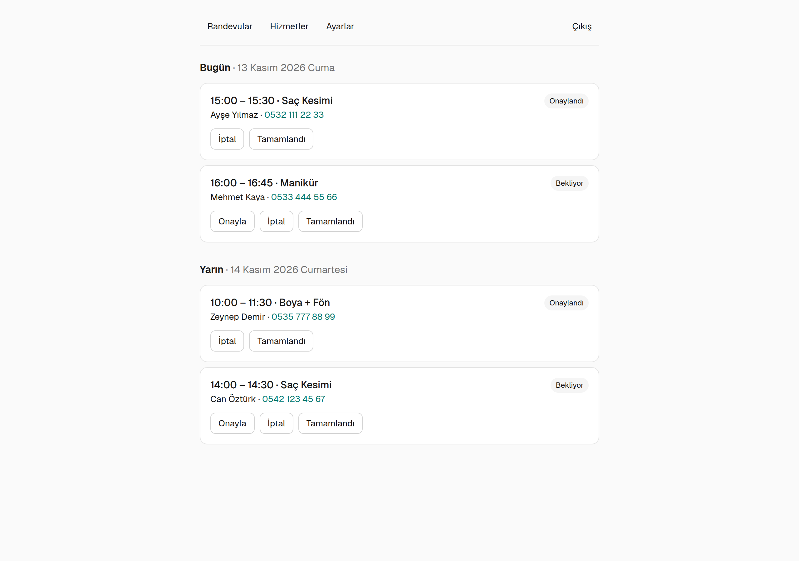

<div align="center">

# Randevum

**Self-hosted appointment booking + SMS reminders for small businesses.**
Turkish-first UI · single-tenant · SQLite · one command to run.

**English** · [Türkçe](README.tr.md)

[](docker-compose.yml)
[](https://nextjs.org)
[](LICENSE)



<sub>The customer page: pick a service, a day and a free slot — no account needed.</sub>

</div>

---

## Why

Micro-businesses in Türkiye — hair salons, beauty studios, dental clinics, barbers, psychologists, vets, auto shops — still take bookings over the phone or through WhatsApp DMs. Appointments get written on paper, forgotten, and no-shows cost real money.

Randevum gives each business **its own booking page** and **its own admin panel**, with **next-day SMS reminders** to cut no-shows. No monthly SaaS, no shared multi-tenant database: the business owns the install and the data file.

## What you get

- **Public booking page** — `/{business-slug}`: pick a service, a day and a free slot. The slot engine respects working hours, service duration, minimum lead time, the maximum advance window and already-booked appointments, so double bookings cannot happen.
- **Admin panel** — `/admin`: today's agenda, appointment status (pending / confirmed / cancelled), services and prices, working hours per weekday, and business settings (slot interval, lead time, advance window, SMS on/off).
- **SMS reminders** — a single cron endpoint that messages tomorrow's confirmed appointments. `stub` provider logs to the console for local dev; `netgsm` provider talks to the real Turkish SMS gateway. A failed SMS never blocks a booking.
- **Turkish by default** — `0532…` / `532…` / `+90…` phone normalization, `Europe/Istanbul` timezone handling, TRY prices, `dd.MM` date display.
- **SQLite** — one file on disk. Backup = copy the file. Nothing else to operate.
- **Docker** — one command, migrations applied automatically, demo business seeded on first boot.

## Admin panel



<sub>Today and tomorrow at a glance, with one-click confirm / cancel / complete.</sub>

## Quick start (Docker)

```bash
git clone https://github.com/Emreceyhnn/randevum.git
cd randevum
cp .env.example .env      # set ADMIN_PASSWORD and CRON_SECRET
docker compose up -d --build
```

- Booking page: <http://localhost:3002/demo>
- Admin panel: <http://localhost:3002/admin>

The container applies migrations on boot and seeds a demo business (3 services, working hours, sample appointments) the first time the database file is created. Data lives in the `randevum-data` volume — it survives rebuilds.

## Quick start (Node.js 22+)

```bash
npm install
cp .env.example .env      # set ADMIN_PASSWORD and CRON_SECRET
npx prisma migrate dev
npx prisma db seed
npm run dev
```

## Configuration

| Variable | Default | Purpose |
| --- | --- | --- |
| `DATABASE_URL` | `file:./dev.db` | SQLite file. In Docker it is `file:/data/randevum.db` (persistent volume). |
| `ADMIN_PASSWORD` | — | Admin panel password. Change it; the stored hash is derived from it. |
| `CRON_SECRET` | — | `Bearer` token for the reminder endpoint **and** part of the session-cookie signing key. Change it. |
| `SMS_PROVIDER` | `stub` | `stub` (logs to console) or `netgsm`. |
| `NETGSM_USERNAME` / `NETGSM_PASSWORD` / `NETGSM_HEADER` | — | Netgsm credentials, only for `SMS_PROVIDER=netgsm`. |
| `SEED_DEMO` | `true` | Seed the demo business on first boot (Docker only). Set `false` for a clean install. |

## SMS reminders

Call once a day — e.g. 18:00 Istanbul time, from cron or a systemd timer:

```bash
curl -H "Authorization: Bearer $CRON_SECRET" https://your-domain/api/cron/reminders
```

Every **confirmed** appointment for tomorrow without a `smsSentAt` gets one message, then is marked as sent. Re-running the endpoint is safe.

```
0 18 * * * curl -fsS -H "Authorization: Bearer $CRON_SECRET" https://your-domain/api/cron/reminders
```

## Deployment notes

- Any host with a **persistent disk** works: VPS, Railway, Fly.io with a volume, a Raspberry Pi. SQLite needs a real filesystem — serverless platforms with ephemeral storage (e.g. Vercel) will lose data on every deploy; on those, switch Prisma to Postgres.
- Run `npx prisma migrate deploy` on release (the Docker image does this for you).
- Put it behind HTTPS and keep `ADMIN_PASSWORD` / `CRON_SECRET` long and random.
- Timezone is fixed to `Europe/Istanbul` — the app deliberately does not pretend to be timezone-agnostic yet.

## Project layout

```
src/app/[slug]      public booking page + server actions
src/app/admin       admin panel (agenda, services, working hours, settings)
src/app/api/cron    reminder endpoint
src/lib/slots.ts    slot generation / availability rules
src/lib/sms.ts      SMS providers (stub, Netgsm)
prisma/             schema, migrations, demo seed
```

## Status & roadmap

Working end to end. Next on the list:

- [ ] Per-business timezone (multi-country)
- [ ] Email confirmations next to SMS
- [ ] iCal feed for staff calendars
- [ ] Optional Postgres adapter

Issues and pull requests are welcome — small, focused ones get merged fastest.

## License

MIT © Emre Ceyhan
